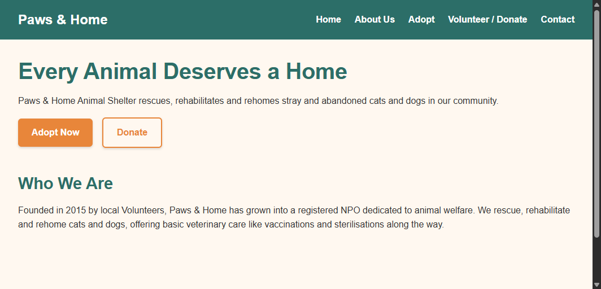
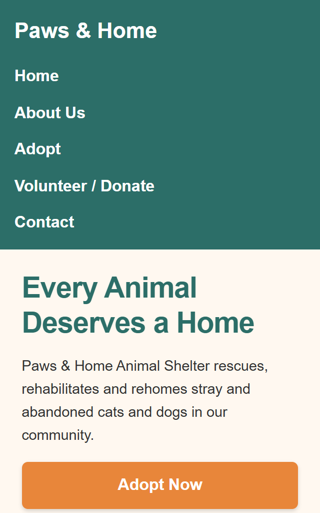

# WEDE Part 3: Paws & Home Animal Shelter - Website Project

## Student Information
- Student Number: ST10453607
- Module: WEDE5020 (Web Development)
- Repository: WEDEpart2
- Live Site: https://st10453607.github.io/WEDEpart2/

## Project Overview
Paws & Home Animal Shelter is a Non-Profit Organisation founded in 2015, dedicated to rescuing, rehabilitating and rehoming stray and abandoned cats and dogs. This project builds the organisation's first website, replacing their reliance on a single Facebook page, to raise awareness, build public trust and credibility, showcase adoptable animals and enable donations and volunteer/foster enquiries.

## Website Goals and Objectives
- Raise awareness of the organisation and its mission
- Build a trustworthy, credible public image
- Provide a structured way for visitors to browse adoptable animals
- Enable online donations and volunteer/foster enquiries
- Improve discoverability via Google search

## Key Features and Functionality
- Homepage with hero section and clear calls to action
- About Us page with mission, vision and success stories
- Adoptable animals gallery with JavaScript filtering (Part 3)
- Volunteer/foster and donation enquiry page with JavaScript form validation
- Contact page with multiple locations and a validated contact form
- SEO optimization with robots.txt and sitemap.xml

## Timeline and Milestones
| Milestone | Status | Date |
| --- | --- | --- |
| Part 1: Website Project Proposal | Completed | - |
| Part 1 feedback received (60%) | Completed | - |
| Part 1 implementation catch-up (HTML structure, file structure, GitHub repo) | Completed | 2026-09-24 |
| Part 2: CSS Styling and Responsive Design | Completed | - |
| Part 3: JavaScript functionality and SEO | Completed | 2026-11-02 |

## Part 1 Details
Part 1 covered organisational research and planning for two candidate organisations. Paws & Home was confirmed as the organisation for development. Part 1 scored 60/100 — the written proposal was strong, but no HTML pages were submitted at the time. This has since been corrected.

## Sitemap
- `index.html` - Homepage
- `about.html` - About Us
- `animals.html` - Adoptable Animals (with JS filtering)
- `enquiry.html` - Volunteer / Donate (with JS validation)
- `contact.html` - Contact (with JS validation)

## Responsive Testing Evidence
**Desktop view:**

**Tablet view:**

**Mobile view:**

## Changelog

### [Part 1 Feedback Fix] - 2026-09-24
- Added all 5 required semantic HTML pages.
- Created the required folder structure.
- Set up GitHub repository and pushed full file structure.

### [Part 2] - Completed
- Added CSS reset, typography scale using rem units
- Implemented Flexbox layout for navigation and content
- Added visual styles, hover/focus states and card/form styling
- Added responsive breakpoints for tablet and mobile

### [Part 3] - Completed - 2026-11-02
- Implemented JavaScript filtering for animals gallery
- Added JavaScript form validation for enquiry and contact forms
- Added SEO files: `robots.txt` and `sitemap.xml` for search engine crawling
- Implemented speed and security measures (defer, lazy loading, textContent, noopener)
- Deployed site to GitHub Pages: https://st10453607.github.io/WEDEpart2/

## Speed and Security Measures
- `defer` on all scripts in HTML to improve loading speed
- `loading="lazy"` on all images
- Compressed images for faster loading
- HTTPS via GitHub Pages
- User input shown with `textContent` (not innerHTML) to prevent XSS
- `rel="noopener noreferrer"` on all `target="_blank"` links
- Added `robots.txt` and `sitemap.xml` for search engine crawling

## References
Garrett, J.J., 2010. *The Elements of User Experience: User-Centered Design for the Web and Beyond*. Pearson Education.

Almeida, F. and Monteiro, J., 2017. The role of responsive design in web development. *Webology*, 14(2), pp.48-65.

Denison, T. and Williamson, K., 2013. Website management issues for community-based, non-profit organizations in rural and regional areas: a comparative Australian/Italian study. *Information, Communication & Society*, 16(7), pp.1072-1092.

Murphy, G.B. and Smart, D., 2000. New and small e-commerce ventures: The importance of legitimacy and trust. *New England Journal of Entrepreneurship*, 3(1), p.33.

Thelwall, M., 2000. Effective websites for small and medium-sized enterprises. *Journal of Small Businesses and Enterprise Development*, 7(2), pp.149-159.

Nageswarakurukkal, K., Goncalves, P. and Moshtari, M., 2020. Improving fundraising efficiency in small and medium sized non-profit organizations using online solutions. *Journal of Nonprofit & Public Sector Marketing*, 32(3), pp.286-311.

Purwati, Y., 2011. Standard features of e-commerce user interface for the web. *Researchers world*, 2(3), p.77.